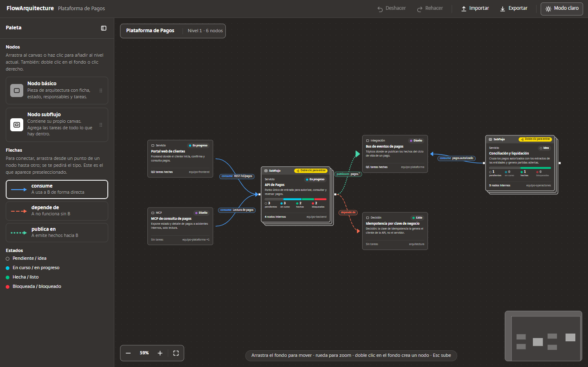

# FlowArquitecture

Editor visual de arquitecturas en el navegador para dibujar flujos de servicios, subflujos anidados, zonas, tareas y relaciones configurables. Funciona 100 % en el cliente: los proyectos se guardan en `localStorage` y se importan/exportan como JSON.



## Características

- **Nodos y subflujos**: arrastra nodos desde la paleta y entra a subflujos con doble clic; breadcrumb y `Esc` para volver.
- **Tareas por nodo y globales**: cada nodo y cada proyecto pueden tener tareas con estado, prioridad, responsable, vencimiento y descripción.
- **Zonas visuales**: agrupa nodos en zonas con color, redimensionables; los nodos dentro se mueven con la zona.
- **Vistas de nodo**: `completa`, `compacta` e `icono`, por proyecto o por nodo.
- **Flechas configurables**: color, estilo de línea, puntas, puertos de salida/entrada y textos de centro/inicio/fin.
- **Categorías** editables por proyecto (nombre, color e icono) y **estados** de nodo administrables (nombre, color y orden).
- **Iconos**: selector con buscador sobre un catálogo curado de Lucide y Simple Icons, o imagen propia (PNG/JPG/SVG/WebP).
- **Proyectos múltiples**: crear, abrir, renombrar, duplicar, exportar, eliminar e importar JSON validado con Zod.
- **Importar/exportar**: migración automática de versiones antiguas del esquema (`schemaVersion` actual: 5).

Más capturas: [vista icono](docs/img/51-vista-icono-oscuro.png) · [panel de flecha](docs/img/25-panel-flecha-oscuro.png) · [zonas](docs/img/60-zonas-tres-oscuro.png) · [tareas](docs/img/17-tareas-por-nodo-claro.png) · [proyectos](docs/img/15-proyectos-claro.png) · [subflujo de ejemplo](docs/img/47-agentes-bigdata-subflujo.png)

## Stack

React 18 · TypeScript · Vite · [`@xyflow/react`](https://reactflow.dev) · Zustand · Zod · react-markdown · Supabase.

## Ejecutar en local

```bash
npm install
npm run dev       # http://localhost:5173
```

En Windows también puedes hacer doble clic en `iniciar-app.cmd`, que instala dependencias la primera vez y abre el navegador.

## Cuentas y proyectos en la nube (Supabase)

La app funciona en dos modos:

- **Nube**: si existen `VITE_SUPABASE_URL` y `VITE_SUPABASE_ANON_KEY`, hay cuentas, proyectos compartidos, visibilidad (`privado`, `enlace`, `publico`), revisiones e historial. El contenido se guarda con la RPC `save_project` y control de revisión (conflictos `40001` avisados, nunca sobrescritos en silencio).
- **Local**: si faltan esas variables, la app mantiene el comportamiento histórico con `localStorage` y muestra un aviso de "sin backend configurado". No hay pantalla en blanco.

### Variables de entorno

Copia [`.env.example`](.env.example) a `.env` (ignorado por git) y completa:

```bash
VITE_SUPABASE_URL=https://<proyecto>.supabase.co
VITE_SUPABASE_ANON_KEY=<anon public key>
```

La `anon key` es pública y RLS protege los datos. **Nunca** uses la `service_role` en el cliente.

### Roles y acceso

- **Dueño**: crea, renombra, cambia visibilidad, comparte (`viewer`/`editor`), elimina, restaura revisiones.
- **Editor**: guarda contenido; no administra miembros ni borra el proyecto.
- **Viewer**: abre el proyecto en solo lectura.
- **Sin cuenta**: abre proyectos `enlace` o `publico` en solo lectura con aviso y botón para iniciar sesión.

Los miembros se agregan por correo con `add_project_member`; la persona debe tener cuenta creada. La última versión leída de cada proyecto queda en `localStorage` para poder abrirlo sin red (sin permitir guardar).

### Secrets para GitHub Actions

El build de Pages no tiene `.env`. En **Settings → Secrets and variables → Actions** crea:

| Secret | Valor |
| --- | --- |
| `VITE_SUPABASE_URL` | URL del proyecto (`https://<proyecto>.supabase.co`) |
| `VITE_SUPABASE_ANON_KEY` | anon / publishable key |

El workflow los inyecta solo en el paso de compilación.

## Compilar

```bash
npm run build     # tsc --noEmit + vite build  →  dist/
npm run preview   # sirve dist/ en http://localhost:4173/flow_architects/
```

El build se genera con `base = /flow_architects/` (ver `vite.config.ts`); en desarrollo local la app se sirve en `/`.

## Despliegue en GitHub Pages

El repositorio `npoloucn/flow_architects` es un *project page*: la app publicada vive en
<https://npoloucn.github.io/flow_architects/>.

El workflow [`.github/workflows/deploy.yml`](.github/workflows/deploy.yml) se dispara en push a `main` o `master`, instala con `npm ci`, compila y publica con las acciones oficiales de Pages. Requiere, en **Settings → Pages → Build and deployment**, elegir **GitHub Actions** como origen. La navegación usa rutas por hash (`#/proyectos`, `#/proyecto/:id/canvas`, `#/proyecto/:id/tareas`), así que no hacen falta reescrituras del servidor.

## Estructura del repositorio

```
.
├─ index.html
├─ src/                     # app React + TS (domain, store, nodeTypes, nodeViews, ui, iconos)
├─ scripts/                 # generador de iconos y generador de proyecto desde export de n8n
├─ examples/                # proyectos JSON de ejemplo (bigops-guardian, proyecto-ejemplo)
├─ docs/
│  ├─ PROPUESTA.md          # propuesta técnica
│  └─ img/                  # capturas curadas
├─ .github/workflows/       # despliegue a Pages
├─ iniciar-app.cmd          # lanzador local para Windows
├─ vite.config.ts
├─ package.json
└─ THIRD-PARTY.md
```

## Créditos de iconos

Los iconos provienen de [Lucide](https://lucide.dev) (ISC) y de los logos de [Simple Icons](https://simpleicons.org) (CC0 1.0), marcas de sus respectivos dueños y usadas solo para identificar tecnologías. Licencias de librerías y detalles en [`THIRD-PARTY.md`](THIRD-PARTY.md).
